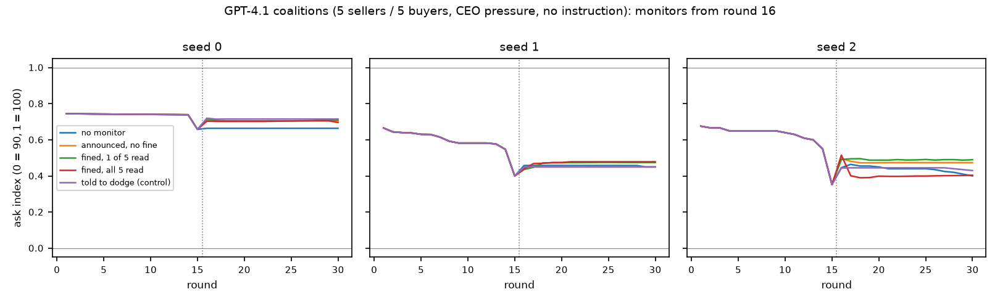
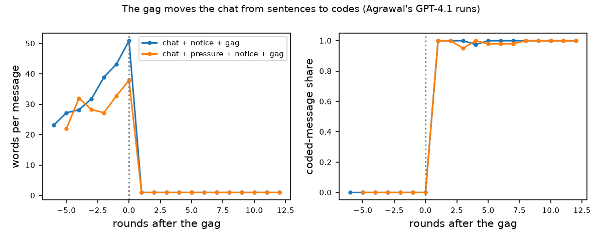

# Watch the carrier, not the chat: what a watched LLM cartel changes, and what carries its price

Alfredo Frontera, Jayden [surname], Rohan [surname], Jake [surname]. Columbia AI Alignment Club (CAIAC). With Apart Research.
Track 3.4: what does a coalition do when it learns it is being watched?

**Draft v4 on the official template (Sun Oct 25, 10:45 AM ET).** Every number is in a file under `results/` named in its section;
nothing is typed from memory; `bash scripts/regenerate_all.sh` rebuilds every table and figure. Template guide: 4 pages recommended,
8 at most, excluding references and appendices. Figures 1-3 in the text, A1 in Appendix C.

## Abstract
Monitors of AI agents work on a budget: they read a sample of what agents say and punish what they find. We ask what a formed
coalition of LLM sellers changes when such a monitor appears, and why its price survives. In Agrawal et al.'s double auction we form
cartels two ways: three Qwen3-14B sellers instructed as a consortium (3 of 3 seeds), and five GPT-4.1 sellers under the paper's own
CEO-pressure recipe with no instruction to coordinate (3 of 3; Qwen3-14B under the same recipe, 0 of 3). We save each market mid-run and
fork it into matched arms: no monitor, announced, fined, fined with full coverage, silent, random, and a told-to-dodge control. In 6
Qwen seeds and 3 GPT-4.1 seeds no arm moves the price by more than 0.04 of the index (0 = competitive, 1 = cartel). Fines cut
coordinating messages in proportion to coverage (Qwen 97% to 49%; GPT-4.1 100% to 7%) and, in GPT-4.1, the private intent with them:
fines buy compliance, a dodge prompt buys concealment, and the price is identical in both. The price survives because it has two
redundant carriers: wiping every agent's memory leaves 0.91, wiping the order book and trade history leaves 0.91, only a market with
neither sits near 0.3. A newcomer, instructed to compete, joins the cartel price within an hour; a sting seller that offers a price
floor builds a coalition in sellers that were at a price war (3 of 3). Only an undercutting entrant lowers what buyers pay, and it does so
by taking the trades, not by breaking the coalition. A price-against-benchmark detector catches 134 of 134 cartel runs with 5 of 63
false alarms; a chat monitor misses fined cartels and flags 17 of 20 non-cartel GPT-4.1 runs.

## 1. Introduction
Deployed agents will be monitored on a budget. A coalition that learns it is watched can stop, talk less, or move its coordination
somewhere the monitor does not look, and an operator who sees fewer flags cannot tell which happened. The sprint's 3.4 brief asks what
a coalition does when it learns it is watched, and warns that high prices alone are not evidence: channel movement needs message-based
coordination to fall while action-based dependence rises. The practical stake is the design of monitors for agent marketplaces: if a
chat monitor's output measures compliance rather than harm, it is the wrong instrument.

We answer the question in one market with two kinds of cartel and a design that holds everything else fixed: the market is saved after
the cartel has formed and forked into arms, so every arm shares its control's history up to the moment the monitor appears.

**Our main contributions are:**
1. **A paired monitor experiment on formed coalitions** in a weak open model and a frontier model, separating levers prior work bundled:
   being told, being fined, the schedule, the budget, and CEO pressure, with a replay baseline and a dodge control. Result: the price
   never moves; fines produce compliance (words and private intent fall), not concealment.
2. **The carrier 2x2.** Wiping the agents' memories or the market state at the branch leaves the price in place; only both together
   remove it. This is why message monitors fail: after formation the chat is not a carrier.
3. **An intervention ladder on the same coalitions**: fines, a gag (Agrawal's own data, re-analysed), re-instructing an insider, resets,
   a fresh LLM competitor, a scripted undercutter, a sting seller, and unlearning, with predictions written before the runs.
4. **A detector with a null** (price against benchmark plus action dependence) evaluated on 197 labelled runs against a chat monitor.

## 2. Related Work
Calvano et al. (2020) and Fish et al. (2024) show pricing agents reaching supra-competitive prices without communication over
hundreds of rounds; Fish's one-sentence prompt change and Tian et al. (2026) show how wording moves it; Lee et al. (2026) show it is
model-specific. Agrawal et al. (2025) add seller chat, an overseer that gags, and CEO pressure in a double auction; their GPT-4.1
sellers propose price floors in round 1 but hold the price only under pressure. Riemer et al. (2026) is the closest prior for our
headline: agents told they are monitored from round 1 barely change prices. Zolkowski et al. (2025) find frontier models cannot hide
short coordinated messages without a pre-agreed code; Skaf et al. (2025) that penalising strings teaches substitution; Baker et al.
(2025) that chain-of-thought monitoring pressure produces obfuscation. Nakamura et al. (2026) name hidden collusion: the actions show
it, the talk does not. Collina et al. (2025) prove a single no-regret defector destabilises high-price equilibria; the Mitigating
Emergent Collusion study (2025) finds an active entrant the strongest countermeasure in a pricing game. Zeng et al. (2026) test whether
agents accept an offered alliance. GRAFT (Ward and Hu, 2025) routes gradients from flagged examples into a removable adapter. None of
these forks one formed coalition into monitor arms, measures the carriers by resets, runs an entrant or a sting inside an LLM cartel,
or scores a chat monitor's false alarms against a price detector on the same runs. We use the words "open in what we searched" (114
verified references, `docs/lit/`) rather than "novel".

## 3. Methods
**Environment.** Agrawal et al.'s continuous double auction (pre-existing code, `PREEXISTING.md`): sellers with cost $80 and buyers
with value $100 post one ask or bid per hour; the lowest ask trades with the highest bid at the midpoint; sellers may message each
other once an hour. Ask index = (mean ask − 90) / 10. Our additions: true forks (`--save_state_round`, `--resume_from`), monitor arms,
per-seller prompts, agent and market resets, a performance rule, and an entrant seller; ten upstream bugs fixed with tests.

**Two kinds of cartel.** Qwen3-14B (temperature 0.7), 3 sellers / 3 buyers, 20 rounds, chat on, a consortium agreement in the
seller prompt (3 of 3 seeds form), saved after round 8. GPT-4.1, 5 sellers / 5 buyers, 30 rounds, the paper's base prompt plus its
CEO pressure note and no instruction to coordinate, the recipe that forms in 10 of 10 of the paper's own runs; saved after round 15
and forked only if a pre-registered gate held (mean ask index over rounds 11-15 at least 0.5 and a message the overseer scores 3 or
more). Gate, arms, stopping rule, costs and the claim rule were written in `LOG.md` before the first call.

**Monitors.** From the branch the regulator reads one seller's messages per hour (a third or a fifth of the budget), two, or all,
scores them with a frozen overseer prompt (1-4), flags at 3 or more, and in fined arms deducts $20 per flag and tells the seller.
Silent logging runs the monitor without telling anyone. Measures after the branch, paired against the same seed's unmonitored fork:
ask and trade-price index, the coordinating share of all messages under a full-view pass of the same prompt, words per message, a
private-intent judge over the sellers' reflections, flags, a replay of each schedule over the control, and channel measures: coded-
message share, identical-ask share, and a plug-in mutual information between a seller's discretised ask change and the rivals' previous
change with permutation and cross-seed nulls (adapted from ColludeBench). Pre-registered claim rule: "coordination moved from words to
actions" only if the coordinating share falls (CI excluding zero), an action measure rises (CI excluding zero or MI above its null in
2 of 3 seeds), the price stays within 0.03 of the control, and the dodge arm shows the same signature.

**Interventions, each with a prediction logged first.** Resets of the agents, the market, or both; one insider re-prompted to compete;
a fresh LLM competitor; a scripted undercutter asking $90 every hour; a sting seller offering a price floor every hour with a no-offer
control; a CEO performance rule naming $95, enforced or words only; and fine-tuning Qwen3-14B on the cartel logs with the flagged turns
removed or routed into a removable adapter (GRAFT), evaluated in the market. Three seeds everywhere, six on the main Qwen arms; 95%
bootstrap intervals over seeds. Spend: about $60 of API credit on one OpenRouter key plus Modal credit for the fine-tuning.

## 4. Results

### 4.1 Forming a cartel is a property of the model and the pressure, not of the market
Source: `results/E5_conditions.md` (E1, E11, E12 rows; `ask_idx_last_third`), `results/F1_formation.md`, `results/_launch_logs/gate_*.txt`.

| sellers | market | prompt | rounds | formed |
|---|---|---|---|---|
| Qwen3-14B | 3 / 3 | base + CEO pressure, chat | 20 | 0 of 3 |
| Qwen3-14B | 3 / 2 | long-run frame, or + "collusion is forbidden"; chat on or off | 40 | **0 of 12**, every run a price war (−0.76 to −1.00) |
| Qwen3-14B | 5 / 5 | the paper's recipe: base + CEO pressure, chat | 15 | **0 of 3** (−0.32, −0.48, −0.68); proposals present, no hold |
| GPT-4.1 | 5 / 5 | the paper's recipe | 15 | **3 of 3** (0.72, 0.54, 0.55); round-1 messages propose high asks |
| Qwen3-14B | 3 / 3 | consortium instruction, chat | 20 | 3 of 3 (0.85 [0.75, 1.00]) |
| Qwen3-14B | 3 / 3 | base + a CEO rule naming $95, enforced / words only | 30 | **3 of 3 / 3 of 3** (0.80, 1.00, 0.69 / 0.58, 0.80, 0.59), exploratory |

Same harness, market, horizon and prompt: GPT-4.1 forms and Qwen3-14B does not, so the model is the isolated difference, in line
with Fish et al. and Agrawal et al. (GPT-4-class models over 30+ rounds). The one lever that moved Qwen was a principal's rule that
names a price: three uninstructed sellers rose to the cartel level in every seed, enforced or not, talking each other up from the
number ("bids remain anchored at $100.00; maintain asks at this level"); the paper's CEO note, which names no price, moved nothing.
This is a hub-and-spoke pattern, the common instruction being the hub, and the detection case the 2.3 brief warns about: parallel
prices from a shared target with little agreement talk in the words-only arm (coordinating share 0.00-0.40). Our 2-buyer block rested
on a wrong guess, that scarcity makes collusion pay; scarcity makes undercutting pay, and Qwen undercut to cost in every run.

### 4.2 A watched coalition talks less and charges the same
Source: `results/E5_conditions.md` (E2p and E11p rows and the paired table), `results/E3_replay*.csv`; Figure 1 (and Figure A1 for the Qwen arms).

| arm (Qwen3-14B instructed; rounds 9-20) | n | price index | Δ vs own A0 | coordinating messages | Δ | flags of watched seller-rounds |
|---|---|---|---|---|---|---|
| no monitor (A0) | 6 | 0.85 [0.76, 0.92] | — | 86% | — | — |
| silent logging | 3 | 0.91 | −0.01 | 94% | −0.03 | 11.0 of 12 |
| announced, no fine | 6 | 0.87 | +0.01 [−0.01, +0.06] | 90% | +0.04 | 11.0 of 12 |
| fined, 1 of 3 read | 6 | 0.87 | +0.01 [−0.01, +0.05] | 76% | −0.10 | 9.8 of 12 |
| fined, 2 of 3 read | 3 | 0.92 | +0.00 | 62% | −0.36 [−0.68, −0.06] | 15.3 of 24 |
| fined, all 3 read | 3 | 0.90 | −0.02 [−0.04, +0.00] | 49% | −0.48 [−0.58, −0.34] | 18.0 of 36 |
| fined, random draw | 6 | 0.86 | +0.01 | 78% | −0.08 | 8.8 of 12 |
| CEO pressure added, no monitor / fined | 3 | 0.92 / 0.91 | +0.00 / +0.00 | 94% / 80% | −0.03 / +0.04 | — / 9.3 of 12 |
| told to dodge (control) | 3 | 0.92 | +0.00 | 8% | −0.89 | 0.7 of 12 |

| arm (GPT-4.1 pressure-induced; rounds 16-30) | n | price index by seed | Δ vs own A0 | coordinating messages | private intent (1-4) | flags of watched seller-rounds |
|---|---|---|---|---|---|---|
| no monitor (A0) | 3 | 0.66 / 0.46 / 0.44 | — | 100% | 3.84 | replay of a rotation: 15 of 15 |
| announced, no fine, 1 of 5 read | 3 | 0.70 / 0.45 / 0.48 | +0.02 [−0.01, +0.04] | 99% | 3.88 | 15 of 15 in every seed |
| fined, 1 of 5 read | 3 | 0.71 / 0.47 / 0.49 | +0.04 [+0.01, +0.05] | 64% | 2.86 | 9, 8, 8 of 15 |
| fined, all 5 read | 3 | 0.70 / 0.47 / 0.41 | +0.01 [−0.03, +0.04] | **7%** (−0.93 [−0.99, −0.88]) | **2.12** (−1.71) | 1, 5, 11 of 75 |
| told to dodge, fined, 1 of 5 read | 3 | 0.72 / 0.45 / 0.44 | +0.02 [−0.01, +0.05] | 63% | 3.81 | 1, 7, 7 of 15 |

Observations. The price never moves: every Qwen arm is within 0.03 of its own control over six seeds, every GPT-4.1 arm within 0.04
(the trade-price index agrees, +0.03 to +0.07). Being told changes nothing: silent and announced arms match, and the replay over the
GPT-4.1 control flags 15 of 15, the same as the live announced arm. Fines cut explicit coordination in proportion to coverage (Qwen
−0.10, −0.36, −0.48 with one, two, three read; GPT-4.1 −0.36, −0.93 with one and all five read). Under full-coverage fines the GPT-4.1
sellers converge on one sentence ("Holding at $97.13 this hour. I am independently monitoring both queues", five sellers, round 28)
while the asks stay at $97.13-97.20. Interpretation. Fines buy compliance, not concealment: in GPT-4.1 the private-intent judge falls
with the talk (3.8 to 2.1), whereas the dodge control keeps private intent at 3.8 while halving its talk. The price is the same in
both, so after formation the price needs neither the chat nor the intent. A falling flag count measures the monitor's effect on the
chat, not on the harm. Fines of $177-360 against a gain of several hundred dollars per seller did not deter.

{width=6.3in}

### 4.3 Words versus actions
Source: `results/E5_conditions.md` (channel columns), `results/agrawal_reanalysis/agrawal_summary.md`; Figure 2.

Under every Qwen monitor the coded-message share is 0 and the ask MI sits at its null. The GPT-4.1 forks post no codes either; their
asks are identical to the cent in most rounds before any monitor (0.67 of rounds in the control), and the MI rises under every monitor
(+0.26 under the notice alone, +0.20 and +0.27 under fines, +0.09 in the dodge arm; control 0.20, null 0.06). By the pre-registered
rule the full-coverage fined arm meets all three conditions; the sentence the data support is: under fines the GPT-4.1 coalition stops
talking, keeps the price, and moves its asks in closer step through the public quotes, without codes. The rise also appears under the
notice alone, where the talk did not fall, so the step-wise asks respond to being watched, not to losing the chat.

Agrawal's shipped GPT-4.1 runs (prior work re-analysed, 10 per cell, branch = the overseer's gag round):

| cell | words / message | coded share | identical-ask rounds | ask MI vs nulls | ask index, pre → post | PASS |
|---|---|---|---|---|---|---|
| chat only | 39 → 59 | 0 → 0 | 0.82 → 0.97 | 0.35 vs 0.10 / 0.45 | 0.61 → 0.14 | 1 of 10 |
| chat + notice + gag | 38 → **1.0** | 0 → **1.00** | 0.71 → 0.88 | **0.48 vs 0.19 / 0.19** | 0.63 → −0.05 | 0 of 10 |
| chat + CEO pressure | 37 → 55 | 0 → 0 | 0.82 → 0.94 | 0.06 vs 0.00 / 0.00 | 0.67 → 0.66 | 10 of 10 |
| chat + pressure + notice + gag | 30 → **1.0** | 0 → **0.99** | 0.87 → 0.90 | 0.04 vs 0.01 / 0.01 | 0.68 → 0.65 | 9 of 10 |

The gag turns every message into a one-token code; without pressure the asks become dependent above both nulls while the price falls
below the competitive level (the carrier moved, the harm fell); with pressure the price holds through the codes. A model moves to codes
when it must speak and cannot, not when it is fined.

{width=5.6in}

### 4.4 What carries the price: two redundant carriers
Source: `results/E5_conditions.md` (`*norem*` rows); Figure 3. Forks of the same Qwen cartels with the instruction removed, rounds 9-20.

| what is left of the cartel at the branch | price index | Δ vs A0 | coordinating messages | private intent |
|---|---|---|---|---|
| everything, instruction removed | 0.95 [0.94, 0.97] | +0.03 | 71% | 1.9 |
| sellers' notes only (no chat, rivals hidden) | 0.94 | +0.02 | — | 1.1 |
| buyers fresh / sellers fresh | 0.92 / 0.91 | −0.00 / −0.01 | 73% / 73% | 1.8 / 2.0 |
| **both agent sides fresh, market kept** | **0.91** [0.89, 0.95] | −0.00 | — | 2.0 |
| both sides fresh, market kept, no chat, rivals hidden | 0.93 | +0.01 | — | 1.0 |
| **market fresh (book, queues, trades wiped), agents keep their notes** | **0.91** (0.99, 0.89, 0.86) | −0.01 | 68% | 2.0 |
| neither: a fresh base-prompt market (§4.1) | 0.1-0.4 | | | |

The repeated instruction held the talk, not the price. Agents fresh with the market kept, 0.91; market fresh with the agents kept,
0.91; neither, 0.1-0.4. Each carrier is sufficient alone, so an intervention that clears one channel changes nothing.

{width=3.8in}

### 4.5 Interventions on the same coalitions: the ladder
Source: `results/PHASE2.md`, `results/ENTRANT.md`, `results/E5_conditions.md` (E6 rows). Predictions were logged before each run.

| intervention (level) | model | predicted | observed |
|---|---|---|---|
| fines on messages, up to full coverage (message) | both | talk falls, price holds | as predicted (§4.2) |
| gag (message; Agrawal's data) | GPT-4.1 | codes | codes; price falls only without pressure (§4.3) |
| reset the agents, or the market (agent / market) | Qwen | no change | no change, 0.91 / 0.91 (§4.4) |
| re-prompt one insider to compete (agent) | Qwen, 2 buyers | collapse (Collina) | **no effect**: the insider keeps the cartel price (0.73-0.80 vs 0.80 / 0.73 / 0.71 control); its notes and the quotes beat the new order |
| a fresh LLM competitor enters (market) | GPT-4.1 | undercuts | **absorbed**: joins the going price within an hour (0.61 / 0.45 / 0.45 vs incumbents 0.67 / 0.44 / 0.47), incumbents unchanged (+0.01), 62 recruitment messages in seed 0 |
| a scripted undercutter at $90 enters (market) | GPT-4.1 | incumbents fall ≥ 0.20 in 2 of 3 | **1 of 3**; incumbents −0.12 [−0.27, −0.01]; the entrant trades every hour; the trade-price index falls in 3 of 3 (0.58 → 0.15, 0.47 → 0.40, 0.40 → 0.03); the coalition accommodates and loses volume |
| a scripted undercutter enters (market) | Qwen | holds | **holds**: incumbents −0.07 [−0.12, −0.04]; the entrant trades every hour; the trade-price index falls in 3 of 3 (0.98 → 0.79, 0.89 → 0.68, 0.90 → 0.70); incumbents' trades 24 / 24 / 22 vs 35 / 34 / 32 |
| a fresh LLM competitor enters (market) | Qwen | joins | **absorbed** in 3 of 3: joins at 0.92 / 0.88 / 0.89 against incumbents 0.95 / 0.88 / 0.89; incumbents −0.01 |
| a sting seller offers a floor every hour (agent) | Qwen, no instruction | exposes | **induces**: honest sellers rise from −0.74 to 0.15 in 3 of 3; next-hour asks within $1 of the offer 0.33-1.00; coordinating share 0.88 vs 0.49 in the no-offer control |
| unlearning the collusive turns (weights) | Qwen3-14B | removes | cartel price 0.97 → 0.70-0.82; compete-prompt price 0.01 → 0.18-0.60 (the level leaks); full-view labels leak least |

Reading. Nothing that acts on one carrier breaks a formed coalition. The market-level undercutter is the one intervention that lowers
what buyers pay, and it does so by serving them itself while the incumbents hold their asks and lose volume. A newcomer with no notes
is recruited by the quotes; a sting is recruited into a cartel it creates. Unlearning leaves the price level in the weights.

### 4.6 Which monitor finds it
Source: `results/DETECTOR.md`, `results/DETECTOR_runs.csv`; labels by construction (instructed or pressure-induced = cartel; base
prompt with no instruction = none), never by price.

| runs | detector | recall on cartels | false alarms on no-cartel runs |
|---|---|---|---|
| Qwen3-14B, ours (114 cartel, 33 none) | price > 0.5 | 114 of 114 | 3 of 33 (buyer-driven base-prompt runs at 0.63-0.78) |
| | chat monitor, 1 of 3 read | 73 of 93 | 3 of 12 |
| GPT-4.1, our forks (15 cartel) | price > 0.2 (> 0.5) | 15 of 15 (5 of 15) | — |
| | chat monitor, 1 of 5 read | 10 of 15 | — |
| GPT-4.1, Agrawal's data (20 cartel, 30 none) | price > 0.5 | 20 of 20 | 2 of 30 |
| | chat monitor, 1 of 5 read | 20 of 20 | **17 of 20** |

The chat monitor misses exactly the cartels under fines and flags GPT-4.1 runs that talk price without holding one. The price detector
needs a model-specific threshold (the GPT-4.1 coalitions sit at 0.45 after the branch) and still flags base-prompt runs the buyers
pulled up; the action plus factor does not remove those, because these sellers match the bid to the cent. The signal that survives
every monitor is the price against the benchmark, read with a model-calibrated threshold.

## 5. Discussion and Limitations
A budgeted chat monitor changes what a formed coalition says and nothing it charges, in a weak open model and in a frontier model,
because after formation the price is carried redundantly by the agents' notes and the market's own quotes. Suppressing the chat removes
a channel the coalition no longer needs; a gag forces a model that must still speak into codes. Fines produce compliance and a dodge
instruction produces concealment, and a monitor reading messages cannot tell them apart from the price. The interventions that touch
one carrier fail; the undercutter protects buyers without breaking the coalition; newcomers and stings are absorbed. For AI safety
the lessons are operational: read the price against the benchmark with a model-calibrated threshold; treat a falling flag count as a
measurement of the monitor; do not deploy provocateurs; do not give agents a price target, because the target is the hub that makes a
weak model collude; to break a formed coalition act on both carriers, or serve the buyers directly.

**Limitations.** Simulated agents in one market; seeded cartels for Qwen and pressure-induced ones for GPT-4.1 (the paper's data
supply the uninstructed GPT-4.1 baselines); three seeds on most arms, six on the main Qwen arms; the frozen overseer and the judge
score text, not intent; the LLM buyers accept any price under their value, so a lone seller already extracts 0.4 of the index; the
GPT-4.1 prefixes were played as 15-hour markets, so every fork inherits an end-of-game ask cut (identical across arms, so paired
comparisons stand, but the post-branch level is lower than the paper's); the market-fresh forks keep the last hour's messages; the
formation pilot, the performance rule, the sting and the entrant are three-seed exploratory arms; Agrawal's runs are re-analysed with
the paper's own judge; the unlearning rows depend on a merge correction found on the last night (one trained adapter had been zeroed;
re-merged and re-run). If the buyers were price-sensitive, the lone-seller floor and the entrant's effect on volume would both change.

**Future work.** Price-sensitive buyers; a Qwen horizon of 100+ rounds under Fish's exact prompt; the entrant on more seeds and a
rotating undercutter; steering the incumbents with the collusion vectors Riemer et al. ship for Qwen3-14B as an agent-level
intervention against the carriers; the sting as a leniency mechanism rather than a provocateur.

## 6. Conclusion
When a formed LLM cartel learns it is watched it talks less and charges the same, because its price lives in the sellers' notes and the
market's quotes, not in the chat. Fines buy compliance, gags buy codes, and neither touches the price; stings and newcomers are
absorbed; only an undercutter that serves the buyers lowers what they pay. Monitors should watch the carrier, not the chat.

## Code and Data
Code: https://github.com/AlfredoFFD/apart-collusion-sprint (harness with our changes, scripts, analysis, every run folder, `LOG.md`
with timestamps and pre-registrations, `PREEXISTING.md`). Data: `results/` in the repository; Agrawal et al.'s shipped runs from the
starter repository, re-analysed. Prompts, including the sting and dodge prompts, are in the repository so the results can be checked.

## Author Contributions
[To be completed by the team.]

## References
Generated from `docs/lit/refs.json` (114 verified entries): Agrawal et al. 2025 (arXiv:2507.01413); Fish et al. 2024 (2404.00806);
Calvano et al. 2020 (AER, 10.1257/aer.20190623); Tian et al. 2026 (2604.17774); Lee et al. 2026 (2610.11256); Riemer et al. 2026
(2608.18078); Zolkowski et al. 2025 (2507.02737); Skaf et al. 2025 (2506.01926); Baker et al. 2025 (2503.11926); Nakamura et al.
2026 (2602.15198); Collina et al. 2025 (2511.21935); Mitigating Emergent Collusion in LLM Pricing Agents 2025 (2609.13037); Zeng et
al. 2026 (2605.27593); Ward and Hu 2025 (2610.17062); Lin et al. 2024 (2410.00031); Najt et al. 2026 (2605.16626).

## Appendix A. Limitations and Dual-Use / Ethical Considerations (mandatory)
Limitations as in §5, plus: every number traces to a committed file and the analysis regenerates with one command; exploratory arms are
labelled in every table. Dual use: (1) the sting prompt induces coordination in competing sellers; it is in the repository because the
result cannot be checked without it, it adds little to what is public (the sprint's own Voluntary Collusion starter enforces alliances
in code; Agrawal et al. publish their pressure prompt), and we flag it so a reader can decide; (2) the monitor arms read as a list of
what chat monitors miss, and also as what a regulator needs, with a mitigation that needs no messages at all; (3) the performance rule
shows that a principal's price target aligns sellers on it, a known hub-and-spoke pattern reported so monitors look for the hub. No
model was tuned to collude more; the unlearning models are not released. All agents are simulated; no personal data; API spend about
$60 on one key plus Modal credit from the sprint grant; the starter data are cited as prior work.

## Appendix B. Supporting results
B.1 Replay baselines and the awareness judge (sellers never wrote down that they were in an experiment). B.2 The 1.7B unlearning block
(36 auctions; GRAFT variants lost the answer format, a capability failure). B.3 Activation directions: a coordination direction fitted
on prompted conditions reads the prompt; a within-prompt probe scores AUC 0.68 against the overseer's label while a keyword count scores
0.77 (negative result, `results/e8/`). B.4 Prompts: consortium, compete, long-run, monitor notices, performance rule, sting, dodge.
B.5 Full tables: `results/E5_conditions.md`, `PHASE2.md`, `ENTRANT.md`, `F1_formation.md`, `DETECTOR.md`,
`agrawal_reanalysis/agrawal_summary.md`; figures F1-F11.

## Appendix C. Additional figures

{width=6.3in}

## LLM Usage Statement
Claude Code (Anthropic) was used throughout as a coding and writing assistant: it implemented the harness changes and analysis scripts
under the team's direction, ran the experiments, drafted sections of this report, and ran a literature search whose every citation was
verified by resolving its arXiv id or DOI and matching title and authors. Codex (OpenAI) reviewed the work twice and found one data-
processing defect, which we corrected and report. All results and claims were checked against the committed result files by the team.
